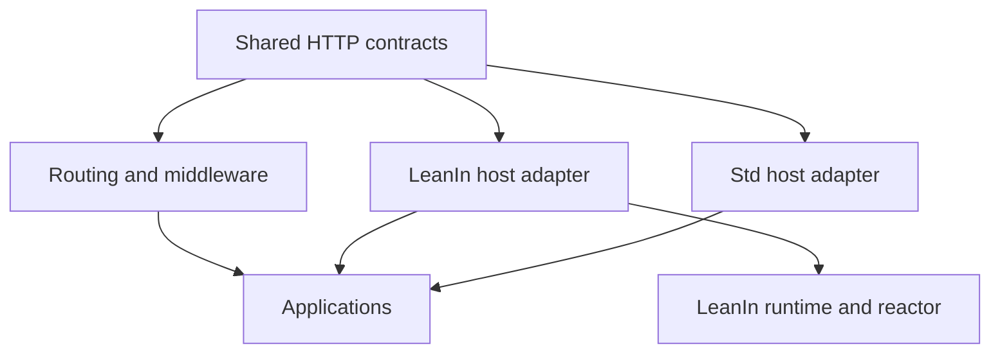

# Plan: a Std-shaped HTTP surface over LeanIn

Date: 22 October 2026  
Status: implementation proposal; the Phase 0–2 boundary is implemented, Phase 3 is partial, and Phases 4–5
remain. The generic handler sketch was corrected: stock hooks run in `Async` while `onRequest` runs in
`ContextAsync`, so the contract carries two monads rather than coercing one.

## Current status

- **Phase 0**: done — VM lexical catch/finalizer fix and `tests/vm-scope.sh`; target-host paired baseline in
  `docs/PERFORMANCE.md`.
- **Phase 1**: done — `LeanIn/Http/Contract.lean` defines `HandlerM m n ReqBody ResBody`, `MiddlewareM`,
  `withHeader` and the `BodyInput` capability. `LeanIn.Http.Stock` instantiates the stock host
  (`ContextAsync`/`Async`, `Body.Stream`/`Body.Any`); `LeanIn.Http.StdHandler` is the LeanIn instantiation over
  `VM`, `Server.BodyReader` and `ResponseBody`. `LeanIn/Test/HandlerContract.lean` compiles the same middleware
  and `readAllBody` helper for both hosts.
- **Phase 2**: done — metadata conversion, `RemoteAddr`, validated heads, `417`, explicit continue policy and the
  settled `onFailure` contract; see D24 and `tests/std-handler-contract.md`.
- **Phase 3**: done except for the explicit trailer boundary — `ResponseBody.bytes`/`.stream` exist. SH5 checks producer cleanup exactly once after
  a complete stream and after a client disconnect. SH6 checks that `HEAD` and `204` suppress the body, keep the
  `HEAD` content length, and skip a stream producer. SH7 checks that a declared length the producer under- or
  over-runs closes the connection and notifies `onFailure`. Trailers are explicitly unsupported: neither
  `ResponseBody` nor the native `ResponseWriter` has a trailer channel.
- **Phase 4**: implemented on `lean-routing` (PR scidonia/lean-routing#1, merged into `leanin-backend`).
  `RequestM`, `ResultM` and `StatelessHandlerM` parameterize the monad and request body; `Routing.Stock` serves
  the same route source at `ContextAsync`/`Body.Stream`. `Routing.Body` adds the request-read and response-body
  capabilities, and `Routing.BodyHandlerM`/`BodyResultM` carry a `ResponseBody` result to both hosts.
  Shared header, matched-route tracing, session, bounded multipart and deferred static-file pilots are tested.
  True streaming multipart needs the LeanIO-style incremental parser adapted to `RequestBody`; handle-backed
  static files need an explicit handle-close primitive. A shared application under both hosts remains the
  integration gate.
- **Phase 5**: not started.

## Objective

Let routing, middleware and applications use familiar Std HTTP data and ordinary Lean monadic code while LeanIn retains its own scheduler, reactor, suspension, streaming and state-machine compilation.

The first deliverable is a native, cooperative handler boundary shared with the web stack. Broader compilation of ordinary monadic code is a later deliverable. A stock-runtime adapter is not the implementation of the native boundary.

## Reviewed baseline

This plan follows the source review of:

- [LeanIn issue #1 and discussion](https://github.com/scidonia/leanin/issues/1).
- [LeanIn main at 7bd55b2](https://github.com/scidonia/leanin/tree/7bd55b2ef41ddab2f7d3b81ffb27ffb6a3e5c9b4).
- [lean-routing LeanIn backend at 4b883ff](https://github.com/scidonia/lean-routing/tree/4b883ffe3ec7d37cbb5fd90c810ae096db1f0b1f).
- [Current native routing boundary](https://github.com/scidonia/lean-routing/blob/4b883ffe3ec7d37cbb5fd90c810ae096db1f0b1f/Routing/Server.lean).
- [LeanIn VM](https://github.com/scidonia/leanin/blob/7bd55b2ef41ddab2f7d3b81ffb27ffb6a3e5c9b4/LeanIn/Runtime/VM.lean).
- [LeanIn HTTP server](https://github.com/scidonia/leanin/blob/7bd55b2ef41ddab2f7d3b81ffb27ffb6a3e5c9b4/LeanIn/Http/Server.lean).

Recheck these observations against the implementation branch before editing. This plan does not claim executed tests, measured adapter costs, or equivalence proofs.

## Architectural decisions

| Concern | Decision |
| --- | --- |
| Metadata | Reuse Std request/response records, heads, headers, status, URI and extensions |
| Computation | Generic handler interface; native LeanIn instantiation |
| Bodies | Explicit capabilities with backend-specific implementations |
| Transport | LeanIn owns framing, writes, backpressure and connection lifetime |
| Metadata conversion | Once per request entering the shared boundary |
| Native interface | Retain the existing slice-based, imperative streaming interface |
| Stock compatibility | Separate adapter with its execution limitations documented |
| Syntax | Ordinary `do` first; optional `async def` lowering later |
| Public naming | Keep `async`; expose concise HTTP aliases in examples |

Shared HTTP records do not require stock `Body.Stream`, `Body.Any`, `ContextAsync`, selectors, or the stock server loop.

Exact Std metadata types require their concrete representation. A macro cannot transparently make a `Headers` map into lazy slices. The native path can avoid this conversion; the shared boundary must measure and account for it.

## Target dependency structure



The shared contracts should depend on Std HTTP data and Lean interfaces, without importing either server implementation. Prototype the contracts in an isolated module; extract a small shared package when both hosts demonstrate that the abstraction works. Agree ownership with the stack maintainer before publishing another foundational dependency.

## Phase 0 — establish semantic and performance baselines

### Work

1. Pin matching Lean and library versions for the integration branch.
2. Record representative current programs: immediate GET, header middleware, typed route, JSON/form POST, suspended handler, streamed response, and disconnect during body consumption.
3. Audit VM catch and finalization behavior before relying on it for resource-owning middleware.
4. Record native dispatch and end-to-end baselines with the existing benchmark methodology.

The reviewed VM appears to extend a `tryE` catch through subsequent binds. The reviewed `MonadFinally` implementation also places its success finalizer inside a catch whose handler invokes the finalizer again. Treat these as source-level findings to reproduce, not established test results.

### Required observations

- A failure after a protected expression has returned is not caught by that expression's local catch.
- The same lexical boundary holds after suspension.
- A finalizer runs once on success, ordinary error and transport abort.
- A failing finalizer is not invoked again.
- Finalizer failure precedence is explicitly chosen and documented.
- A finalizer that suspends retains the same guarantees.
- An abort passes ordinary application catches.

If a finding reproduces, repair the interpreter/scoping representation before building middleware assumptions on it. Do not merely patch individual middleware.

### Exit criterion

The computation behavior required by middleware has executable checks, and baseline records state commits, commands, workload and uncertainty. No performance claim is inferred from a single run.

## Phase 1 — define the shared contracts

### Handler shape

Prototype a parameterized record:

```lean
-- Proposed interface, not current API.
structure HandlerM
    (m : Type → Type) [Monad m]
    (ReqBody ResBody : Type) where
  onRequest :
    Std.Http.Request ReqBody →
    m (Std.Http.Response ResBody)

  onContinue :
    Std.Http.Request.Head → m Bool :=
      fun _ => pure true

  onFailure :
    IO.Error → m Unit :=
      fun _ => pure ()

abbrev MiddlewareM
    (m : Type → Type) [Monad m]
    (ReqBody ResBody : Type) :=
  HandlerM m ReqBody ResBody →
  HandlerM m ReqBody ResBody
```

Keep requirements local. Header middleware needs monadic sequencing and shared records; it should not require sockets, task spawning, clocks or cancellation merely to change a header.

The Std host adapter must bridge its callback distinction: `onRequest` uses `ContextAsync`, while its other callbacks use `Async`. Specify what context hooks receive and who owns it. Do not erase this distinction through an unchecked coercion.

### Body capabilities

Start with the operations demonstrated by the integration programs. The contract must settle:

- Chunk bytes and trailer representation.
- EOF versus ordinary failure versus transport abort.
- Whether a maximum read size is a hard bound.
- Known length and unknown length.
- Explicit close/discard semantics and who owns connection reuse.
- Single consumption and resource ownership.
- Whole-body accumulation limits.

Use separate optional capabilities for readiness, replay or seeking. Avoid requiring a Std selector from every body implementation.

Use bounded body reads for form/JSON accumulation. Generalizing middleware must not remove the native driver's existing limits.

### Exit criterion

A header-only middleware and a body-consuming helper can be written once and instantiated for both hosts without backend-specific metadata accessors. Concrete aliases keep routine application signatures short.

## Phase 2 — implement the LeanIn host boundary

### Work

1. Convert the parsed H1 head into a validated `Std.Http.Request.Head` once when entering this boundary.
2. Attach the native body reader as the body parameter.
3. Populate extensions, including the Std `RemoteAddr` type when peer information is available.
4. Execute the handler on LeanIn's computation machinery.
5. Convert response metadata to native writer operations.
6. Keep the current native `StreamHandler` entry available.
7. Establish one authoritative continue policy so the H1 machine and application hook cannot both send the interim response.

### Hook contracts

- For a supported `Expect: 100-continue` request, await the application's decision before handler invocation/body consumption.
- A refusal sends `417 Expectation Failed`, skips the handler, and follows the documented close policy.
- An acceptance sends the interim response once.
- Distinguish malformed/unsupported expectations from application refusal.
- Specify hook timeout, abort and shutdown behavior.
- `onFailure` is notification-only: it cannot replace an already committed response or turn transport failure into a second response.
- Specify whether unhandled application errors notify this hook; do not rely on the ambiguous phrase “failure”.
- Preserve the original transport outcome if notification itself fails, under an explicit reporting policy.

### Required observations

A handler parked on a controlled completion permits a sibling request to progress. The native adapter must not reach `Std.Async.Async.block` or stock task machinery through body helpers.

Combine import/call-path review with executable behavior; text searches alone do not establish native execution.

### Exit criterion

A shared request-to-response handler runs cooperatively on LeanIn, metadata is correct, and refusal cannot leave a handler waiting for a body the client will never send.

## Phase 3 — provide returned streaming response bodies

A returned `Std.Http.Response γ` can describe a stream. It need not contain an accumulated byte array.

Prototype a native body value with buffered and producer forms:

```lean
-- Proposed design notation.
inductive ResponseBody where
  | bytes : ByteArray → ResponseBody
  | stream :
      (BodySink → LeanIn.Runtime.VM Unit) →
      ResponseBody
```

### Work

- Define a sink whose writes await native transport/backpressure.
- Allow response metadata to be transformed before the driver commits the head.
- Let producers acquire and release their own resources through a bracket.
- Keep producer resources alive until transmission finishes or aborts.
- Define producer cancellation, failure, cleanup and length-mismatch behavior.
- Assign final framing/finish ownership to the driver or body runner; avoid competing finish calls.
- Preserve HEAD and body-forbidden status semantics, with explicit resource disposal when a producer is not run.
- Handle trailers and Content-Length/chunked selection deliberately.
- Retain the imperative writer interface for early hints, immediate commitment and specialized streaming.

### Lifetime rule

Handler return does not end the lifetime of a deferred response body. A handler must not return a producer referring to a file or resource already released by its local `finally`. Prefer acquisition inside the producer, or an explicit owned response resource.

### Exit criterion

A response middleware can modify headers and wrap a streamed body without buffering it. Client disconnect triggers the documented producer cleanup exactly once. Request-scope shutdown does not invalidate resources while a response producer still needs them.

## Phase 4 — generalize lean-routing and representative middleware

### lean-routing

- Preserve its typed routes, reverse links, mounting semantics and route-match extensions.
- Parameterize the HTTP result and handler layers over computation and body types.
- Keep route indexes and middleware composition built once.
- Reuse Std metadata instead of maintaining parallel request/response records and status conversions.
- Provide concrete aliases and host entry points for applications.
- Preserve response extensions so outer telemetry can observe matched routes.

### Middleware pilot

Port a deliberately varied sample before changing the entire stack:

| Pilot | Capability exercised |
| --- | --- |
| Security headers | Shared response metadata |
| Cookies/session | Headers, extensions and effectful storage |
| Tracing | RemoteAddr, matched-route metadata, hook policy |
| Form/multipart | Bounded streaming input and lexical error handling |
| Static file | Deferred resource lifetime and streaming output |

Keep external services out of deterministic contract fixtures; use staged fakes.

### Exit criterion

The same route and middleware source runs under Std and LeanIn with different host setup and concrete aliases. Backend-specific code is confined to adapters and genuinely backend-specific capabilities.

Use one small shared application as the integration gate, rather than maintaining two nearly identical examples.

## Phase 5 — improve authoring syntax

Only add syntax after the underlying types and behavior are useful through ordinary functions.

### First slice: builders and aliases

Provide concise `Http.Handler`, request/body aliases, and response builders returning shared metadata with a native body value. Preserve useful source idioms such as `request.line.uri` and `response.line.headers`.

Builders must not construct stock `Body.Any` internally on the native path. Prefer ordinary definitions and typeclass instances; use macros where they improve inference or remove repetitive declarations.

### Second slice: compiled declarations

Target approximately:

```lean
-- Proposed syntax; not currently supported in this form.
async def echo (request : Http.Request) : Http.Response := do
  let bytes ← request.body.readAll
  return Http.Response.ok.bytes bytes
```

Investigate elaboration before lowering so the compiler sees resolved calls, local types, patterns and control flow. Support ordinary helper calls through a documented compilation rule or a native compositional bridge.

Do not assume a textual `←` to `await` rewrite can compile arbitrary middleware. Opaque higher-order code requires a bridge or specialization; it cannot be fully defunctionalized from its caller's syntax alone.

Keep generated states available for inspection and reasoning. Preserve the efficient direct-call path; familiar helper syntax must not require a completion cell for every sequential call.

### Exit criterion

Extracting a handler fragment into a helper preserves results, error scope, cancellation and cleanup. Supported compiled code and its monadic counterpart agree on observable outcomes in the acceptance programs. State precisely which correspondence remains unproved.

## Performance gate

Measure these dimensions separately:

1. Metadata conversion and allocation.
2. Dispatch and middleware overhead.
3. Immediate versus genuinely suspended handlers.
4. Buffered versus streaming bodies.
5. Connection churn and keep-alive behavior.
6. Native entry versus shared boundary.

Use paired/interleaved before-and-after runs with response validation. Record throughput, CPU cost where available, latency distribution and memory/allocation evidence. Preserve workload and transport settings.

Agree an acceptable regression budget from baseline variability before deciding whether to make the shared boundary the default. If conversion is material, profile and optimize it or retain an explicit native entry; do not hide a second representation behind misleading claims of identical cost.

No specific retained speedup is promised by this plan.

## Suggested PR sequence

| PR | Scope | Review gate |
| --- | --- | --- |
| 1 | VM scope/finalization reproduction and any required repair | Lexical catch scope; exactly-once cleanup |
| 2 | Shared handler/body contract prototype and both host adapters | One generic header middleware and body helper |
| 3 | LeanIn metadata boundary and hook integration | Cooperative suspension; RemoteAddr; refusal skips handler |
| 4 | Native returned streaming body | Backpressure; resource lifetime; disconnect cleanup |
| 5 | Generic lean-routing and middleware pilot | One application source on both hosts |
| 6 | Aliases, builders, migration guide and examples | Routine code needs no raw completion/executor plumbing |
| 7 | Broader compiled authoring support | Helper extraction and interpreted/compiled behavior checks |

PRs 2–3 may evolve together on an integration branch. Settle the contract before migrating every consumer. Streaming can begin with a narrow implemented body capability; do not advertise full generality until the pilot exercises it.

## Release and migration

- Publish the shared boundary additively first where practical.
- Keep explicit entry points for native handlers, shared handlers and stock compatibility.
- Document which entry points can block or invoke stock runtime machinery.
- Migrate lean-routing and LeanIO examples before making a breaking boundary the default.
- Choose the release version against the current release policy; the issue discussion proposed 0.7.0 after 0.6.0, but recheck the release state.
- Document effectful calls, body limits, response commitment, hooks, cancellation and cleanup.
- Deprecate duplicated backend metadata wrappers only after consumers have a tested migration path.

## Completion criteria

The work is complete when an application can use Std-shaped requests and responses, ordinary monadic handlers, typed routes and shared middleware on LeanIn; streamed bodies remain incremental; suspended work remains cooperative; cleanup and hooks have executable contracts; and measured costs are recorded.

The optional compiler work is a further milestone: the same authoring contract can lower supported code to inspectable LeanIn state machines without changing application semantics.

